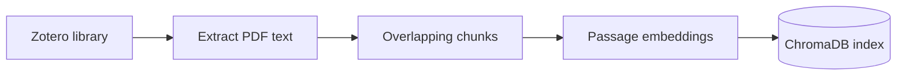
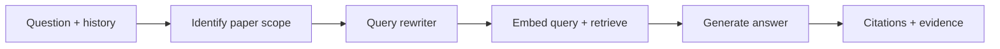

# Zotero RAG Research Assistant

A retrieval-augmented generation (RAG) application for exploring scientific literature in a Zotero library. The project connects reference management with semantic search and conversational AI: users can ask questions about their papers, inspect the passages retrieved as evidence, and follow citations back to a PDF page.

Built with Python, Streamlit, PyZotero, PyMuPDF, OpenAI, and ChromaDB, the application implements the pipeline from PDF ingestion through passage retrieval and answer generation. It supports both personal and group Zotero libraries.

> **Accuracy validation is pending.** The system has not yet been validated for retrieval accuracy, answer accuracy, or whether cited passages support generated claims. It is a research prototype; answers and citations should be checked against the original papers.

## How the RAG pipeline works

The application separates preparation of the literature index from answering questions. Papers are processed into a persistent local index, then relevant passages are retrieved for each question and provided to the language model as evidence.

**Library preparation**



**Question answering**



Retrieval searches the ChromaDB index created during library preparation. The query rewriter makes conversational follow-ups explicit before that search.

### 1. Connect and ingest the library

The user supplies a Zotero library ID and API key through the Streamlit interface. The application verifies access, retrieves top-level library items, and looks for PDF attachments. For each eligible item, it downloads the first matching PDF and extracts its embedded text with PyMuPDF.

Each paper is saved as structured JSON containing its Zotero item and attachment keys, title, authors, date, DOI, and text organized by PDF page. Preserving page information makes it possible to show where a retrieved passage came from later in the workflow.

### 2. Clean and chunk the text

Before indexing, the application joins words split across lines by hyphens and normalizes whitespace. Each page is split into passages using a target size of **400 words** with **50 words of overlap**. Short trailing passages may be merged into the preceding chunk.

Overlap is intended to preserve context near chunk boundaries. Chunking stays within individual pages, maintaining a clear connection between each passage and its PDF page. Each chunk receives an identifier derived from its Zotero item key, page number, and chunk position.

### 3. Generate embeddings and store the index

The application sends passage text to OpenAI's **`text-embedding-3-small`** model. An embedding represents a passage as a numeric vector that can be compared with the vector representation of a question.

ChromaDB stores the embeddings alongside the original passage text and bibliographic metadata. The database persists locally, allowing later searches to reuse the index. Embedding runs skip chunk IDs already present in the collection, so newly added papers can be indexed incrementally.

### 4. Identify the paper or topic

For each question, the application determines whether the user is asking about a specific paper or about the literature more generally. Explicit author-year references can be matched against indexed metadata. Other requests use model-assisted identification from a bounded catalog shortlist ranked locally using question terms, recent conversation, and the active paper.

When several papers match, the interface asks the user to choose one while retaining the original question. Once the scope is resolved, a separate query-rewriting stage prepares the search question.

### 5. Rewrite conversational queries

The **query rewriter**, implemented by `rewrite_question()` in `rag_answer.py`, uses `gpt-4.1-mini` to turn a follow-up into a standalone semantic search question. It receives the current question and bounded recent conversation history, with instructions to preserve the user's intent and scientific terminology without answering the question.

For example, after discussing a study of surprisal and the N400 response:

| Input to the conversation | Illustrative rewritten search query |
| --- | --- |
| “What were its limitations?” | “What were the limitations of the study on surprisal and the N400 response?” |

The exact rewrite is model-generated and may vary. With no conversation history, the function returns the original question directly. For a matched paper, the application also prefixes the search query with the selected paper's title and filters retrieval to that paper's Zotero keys.

The rewritten query is used for embedding and retrieval. The original question remains the request used for answer generation; when the user selects a paper after clarification, the application restores the question that prompted the clarification. Rewriting is intended to reduce ambiguity in retrieval, but its effect on accuracy has not yet been evaluated.

### 6. Retrieve supporting passages

The search question is embedded using the same model used for the papers. ChromaDB then retrieves similar passages, optionally filtering by the selected paper's Zotero keys. The interface retrieves eight passages by default, with an adjustable range of three to twenty. Previously cited passages explicitly referenced by source ID can also be added to the evidence.

### 7. Generate an answer with inspectable citations

Retrieved passages are assembled into an evidence context with stable conversation-level identifiers such as `[S1]` and `[S2]`. The application provides this context, the current question, and bounded recent conversation history to **`gpt-4.1-mini`**.

The model is instructed to base scientific claims on the supplied passages, acknowledge missing evidence, and cite source IDs immediately after supported claims. A citation check identifies references to IDs outside the evidence supplied for that answer. This check does **not** establish that a claim is accurate or supported by its cited passage.

The **Retrieved Evidence** panel displays passage text, paper titles, authors, and PDF page numbers so users can inspect the material behind an answer. Conversations and cited source details can be downloaded as HTML.

## Design choices

- **Inspectable evidence:** Retrieved text and page-level metadata are visible alongside the generated response.
- **Conversational query rewriting:** A dedicated model call turns follow-ups into standalone search queries before retrieval. An active paper and stable source IDs provide additional context.
- **Persistent local storage:** Extracted text, chunks, and embeddings are organized by library type and ID.
- **Versioned rebuilds:** A full rebuild creates a separate index version and switches to it only after ingestion, chunking, and embedding succeed. Earlier versions remain on disk.
- **Shared configuration:** Model names and request size limits live in `config.py`. Stored model metadata helps prevent searches against an incompatible embedding index.
- **Bounded requests:** Limits on questions, conversation history, catalog metadata, evidence, and model output keep individual requests from growing without bounds.

## Project structure

| File | Responsibility |
| --- | --- |
| `app.py` | Streamlit interface, pipeline controls, conversation state, and export |
| `zotero_connection.py` | Library ID validation and Zotero access verification |
| `zotero_ingest.py` | PDF retrieval, page-level text extraction, and metadata storage |
| `chunk_papers.py` | Text cleanup and overlapping passage creation |
| `embed_chunks.py` | Batched embedding generation and ChromaDB storage |
| `rag_answer.py` | Paper identification, query rewriting, retrieval, answer generation, and citation ID checks |
| `config.py` | Shared model settings and request limits |
| `library_storage.py` | Active index selection, versioned rebuilds, and model compatibility checks |
| `export_safety.py` | Restricted HTML formatting for conversation exports |
| `requirements.txt` | Pinned Python dependencies |

## Run locally

The development environment uses Python 3.12. From the project folder:

```bash
python3.12 -m venv .venv
source .venv/bin/activate
python -m pip install -r requirements.txt
python -m streamlit run app.py --server.address 127.0.0.1
```

On Windows, activate the environment with `.venv\Scripts\Activate.ps1` in PowerShell instead.

Enter a Zotero user or group library ID, a Zotero API key with read access to the library and its attachments, and an OpenAI API key in the interface. The main application does not require credentials to be written into the source code.

1. Select **Connect to Zotero**.
2. Run **Index My Library**, **Chunk My Papers**, and **Generate Embeddings**, in that order.
3. Ask questions in **Research Chat** and inspect **Retrieved Evidence**.
4. Use **Rebuild Library Index** after replacing or correcting existing papers, removing papers, or changing the embedding model.
5. Use **Download Conversation** to export the discussion, or **New Chat** to reset it.

The incremental controls skip existing paper files, chunk files, and indexed chunk IDs. A rebuild refreshes the full pipeline and starts a new chat after success. It sends paper text for embedding again and incurs API usage charges. Older and incomplete index versions remain on disk.

## Data handling and deployment scope

Extracted text, chunks, and vector indexes are stored under `data/libraries/<library_type>/<library_id>/`. These data folders, local credentials, conversation exports stored in the project export folder, archives, and virtual environments are excluded from GitHub through `.gitignore`. Exports saved elsewhere must be managed separately.

Local storage does not mean all processing is local. Paper passages are sent to OpenAI for embeddings. Questions, retrieved passages, conversation context, and catalog metadata may also be sent for the question-answering workflow. API keys are held in Streamlit session state, and API usage can incur charges.

The application is intended for local, trusted use. It does not implement application login or per-user storage isolation; sessions using the same library share its index. Per-library locks coordinate indexing and chat operations but do not provide access control. A public deployment would require additional authentication and data-access protections.

HTML exports display raw HTML as text, restrict formatting and link types, and include a policy that blocks scripts and external resources.

## Current limitations and future evaluation

The system has not yet been validated for accuracy. Its retrieval settings, chunking choices, and prompts are implementation choices rather than demonstrated performance improvements.

Potential failure modes include missing a relevant passage, selecting the wrong paper, generating unsupported claims, or assigning a valid source ID to a claim that the passage does not support. Retrieval supplies a limited set of passages rather than the complete paper, so summaries and literature-wide answers may omit important evidence. Large catalogs are shortlisted, and older conversation context is omitted from model requests.

PDF extraction relies on embedded text. Scanned documents without a text layer require a separate OCR step, and complex layouts can affect extraction quality. Ingestion currently uses the first matching PDF attachment per item.

Future evaluation should measure retrieval relevance against a labeled question set, answer correctness, citation support, and coverage of the indexed literature. Human review of generated answers against the original papers is needed before making claims about research accuracy or reliability.
